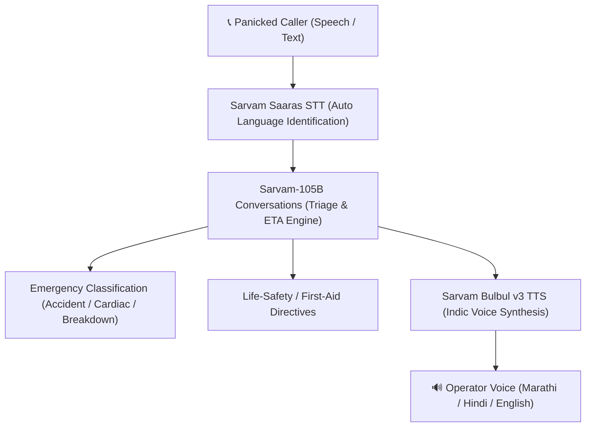

# 🚨 108 Emergency AI Voice Responder & Dispatcher (Sarvam AI)

An autonomous, multilingual emergency response system built for India's **108 Emergency Medical Services**, powered by **Sarvam AI**.

When a citizen dials 108 in panic during an accident, acute medical crisis, or roadside breakdown, the agent:
1. **Detects Language Instantly**: Communicates naturally in Marathi, Hindi, English, Gujarati, Tamil, etc.
2. **Immediate Ambulance Dispatch**: Provides realistic estimated time of arrival (ETA) based on location (8-12 min city, 15-20 min highway).
3. **Emergency Triage**: Accurately classifies trauma accidents, cardiac/breathing distress, vehicle hazards, and fire emergencies.
4. **Life Safety Instructions**: Guides callers with critical first-aid actions (e.g. cervical spine immobilization, bleeding pressure, hazard lights).
5. **Real-time Voice Output**: Synthesizes calm, authoritative operator audio using **Sarvam Bulbul TTS**.

---

## 🏛 Architecture



---

## 🚀 Quickstart & Local Setup

### 1. Clone & Install Dependencies
```bash
git clone https://github.com/YOUR_USERNAME/sarvam-108-emergency.git
cd sarvam-108-emergency
pip install -r requirements.txt
```

### 2. Configure Environment Key
Copy `.env.example` to `.env` and set your key:
```env
SARVAM_API_KEY=your_sarvam_api_key_here
```

### 3. Launch the Web Application
```bash
streamlit run app.py
```
Open your browser at `http://localhost:8501`.

---

## ☁️ Deploying to Streamlit Cloud (share.streamlit.io)

1. Push your repository to **GitHub** or **GitLab**:
   ```bash
   git init
   git add .
   git commit -m "feat: initial commit of 108 emergency responder"
   git branch -M main
   git remote add origin https://github.com/YOUR_USERNAME/sarvam-108-emergency.git
   git push -u origin main
   ```
2. Navigate to [Streamlit Community Cloud](https://share.streamlit.io).
3. Select your repository, set the branch to `main`, and main file path to `app.py`.
4. Under **Advanced Settings ➡️ Secrets**, add:
   ```toml
   SARVAM_API_KEY = "your_sarvam_api_key_here"
   ```
5. Click **Deploy**! Your MVP website will be live worldwide.

---

## 📦 Project Structure

- `app.py`: Interactive Streamlit Web application with live audio synthesis and incident logging.
- `emergency_responder.py`: Core CLI pipeline for prompt processing and voice output generation.
- `main.py`: Minimal test script validating the Sarvam AI connection.
- `requirements.txt`: Minimal dependencies for deployment.
- `.env`: Environment configuration (strictly ignored by `.gitignore`).
